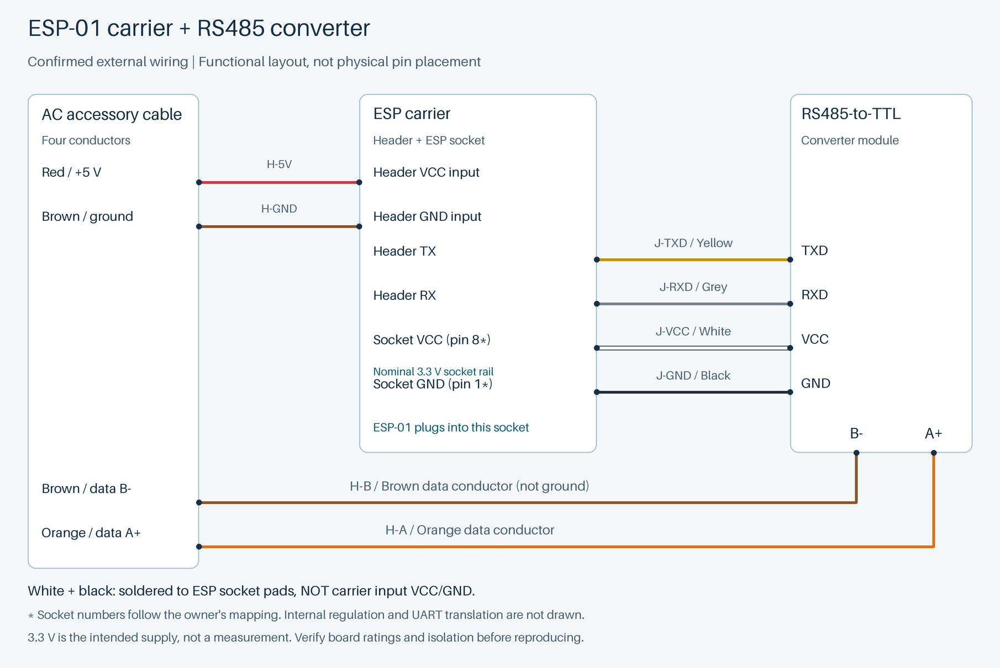

# esphome_hisense_ac

ESPHome external component for controlling Hisense air conditioners that use
the proprietary `F4 F5 ... F4 FB` UART protocol (e.g. the AEH-W4A1 / AEH-W4B1
Wi-Fi modules).

> **Status:** the protocol decoder works, but the receive parser is not
> resync-safe — see [docs/TROUBLESHOOTING.md](docs/TROUBLESHOOTING.md) for the
> known Home-Assistant initialisation bug and the corresponding test suite
> under `tests/`.

## Hardware

The documented RS485 assembly uses an **ESP-01 on an active carrier board**
and an **RS485-to-TTL converter**. The AC's +5 V feeds the carrier input;
the converter takes its nominal 3.3 V supply from the carrier's ESP socket.

See **[hardware wiring and power drawings](docs/HARDWARE.md)** for the
owner-confirmed wire map, socket taps, and board-specific checks.



> A bare ESP-01 must not receive 5 V directly. Some AC connectors expose TTL
> TX/RX, while others expose RS485 A/B; verify the actual unit rather than
> treating those interfaces as interchangeable. The older
> [connector photograph](AC%20connector.jpg) is retained for reference, not
> as a universal pinout.

Logging is over Wi-Fi only (`logger: baud_rate: 0`) because GPIO1/GPIO3 are
reused for the AC UART on the ESP-01.

## Quickstart

1. Copy the component into your ESPHome `external_components` path:

   ```yaml
   external_components:
     - source:
         type: local
         path: components
       components: [hisense]
   ```

2. Use [`esphome/sampleconfig.yaml`](esphome/sampleconfig.yaml) as a starting
   point. Adjust Wi-Fi credentials, API key, and OTA password.

3. Flash and watch the Wi-Fi logs:

   ```
   esphome run esphome/sampleconfig.yaml
   ```

## Development

A pytest suite covers the protocol layer (checksum, frame parse / build,
encoding, climate-state decoding, streaming-parser behaviour) so the firmware
bugs can be fixed without flashing hardware.

```bash
make venv         # create .venv with pytest + esphome
make test         # run the test suite
make config       # validate esphome/sampleconfig.yaml
make compile      # full firmware build (no upload)
make help         # list every target
```

The `output.txt` file in this repo is a live capture from a Hisense unit and
is referenced by the tests as the source of truth for what the firmware sees
on the wire.

## Documentation

- [`docs/HARDWARE.md`](docs/HARDWARE.md) — ESP-01 carrier/RS485 wiring,
  socket power taps, and editable drawings.
- [`docs/PROTOCOL.md`](docs/PROTOCOL.md) — wire format, byte layout, encoding
  tables.
- [`docs/TROUBLESHOOTING.md`](docs/TROUBLESHOOTING.md) — known bugs and
  troubleshooting steps.

## Credits

Prior art that made this possible:

- <https://community.home-assistant.io/t/working-on-integration-for-hisense-aeh-w4a1-module/146243>
- <https://github.com/deiger/AirCon/>
- <https://github.com/simoneluconi/hisense-aeh-w4a1>
- <https://github.com/pslawinski/esphome_airconintl>
