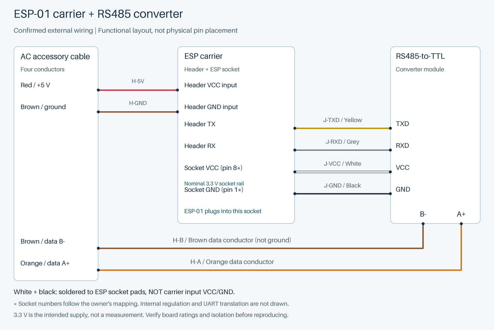
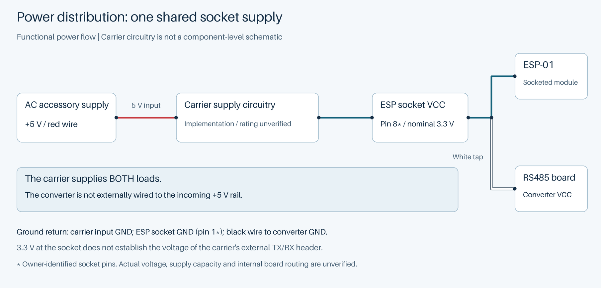

# ESP-01 carrier and RS485 wiring

This documents one assembled controller: an ESP-01 module plugged into an
active carrier board, connected to an RS485-to-TTL converter. The wire endpoints
were confirmed by the assembly owner. It is **not a universal Hisense connector
pinout or a component-level circuit schematic**.

The carrier's internal regulator and level-shifter implementation has not been
reverse-engineered. Supply voltages below describe the intended design, not
measurements or a guarantee of compatibility for every similar-looking board.

## Point-to-point wiring



[Editable vector drawing](diagrams/esp01-rs485-wiring.svg)

The AC cable has four conductors. The two brown conductors are separate wires:
**brown ground is not the brown B− data wire**. The following table identifies
conductors by function; it does not assign physical connector cavity numbers.

| Wire ID | Color / role | Endpoint A | Endpoint B |
|---|---|---|---|
| H-5V | Red / incoming +5 V | AC accessory supply | Carrier header VCC input |
| H-GND | Brown / ground | AC accessory ground | Carrier header GND input |
| H-B | Brown / data | AC RS485 B− | Converter B− |
| H-A | Orange / data | AC RS485 A+ | Converter A+ |
| J-TXD | Yellow / serial | Carrier header TX | Converter TXD |
| J-RXD | Grey / serial | Carrier header RX | Converter RXD |
| J-VCC | White / supply | Carrier ESP socket VCC, pin 8* | Converter VCC |
| J-GND | Black / ground | Carrier ESP socket GND, pin 1* | Converter GND |

```text
AC FOUR-CONDUCTOR CABLE        ESP CARRIER                         RS485-to-TTL

Red (+5 V) ------------------ Header VCC input
Brown (ground) -------------- Header GND input

                              Header TX -------- yellow -------- TXD
                              Header RX -------- grey ---------- RXD

                              ESP socket VCC --- white --------- VCC
                              (pin 8*, nominal 3.3 V)

                              ESP socket GND --- black --------- GND
                              (pin 1*)

Brown (data) --------------------------------------------------- B-
Orange (data) -------------------------------------------------- A+
```

`*` Pin 1 = GND and pin 8 = VCC reproduce the owner's socket-pin identification.
The drawings show **functional connections, not physical pin placement**. Check
the module pinout and board orientation before soldering; an underside view
mirrors the apparent layout.

### Socket power taps versus header connections

- The **red +5 V wire** goes to the carrier's input VCC, not directly to the
  ESP-01's VCC.
- **White and black are soldered to the carrier's ESP socket pads**, where the
  ESP-01 plugs in. They do not use the carrier's four-pin header VCC/GND pads.
- **Yellow and grey use the carrier's header TX/RX terminals**. They are not
  direct taps from the ESP socket's UART pins.
- TX-to-TXD and RX-to-RXD are recorded exactly as wired. These are the boards'
  printed labels; do not infer raw ESP signal direction or swap the wires
  merely because a generic UART diagram shows a crossover.

## Power distribution



[Editable vector drawing](diagrams/esp01-rs485-power.svg)

```text
AC +5 V --> carrier supply circuitry --> nominal 3.3 V socket rail
                                                   |
                                                   +--> ESP-01
                                                   |
                                                   +--> converter VCC (white)
```

The converter deliberately takes its intended **3.3 V supply from the ESP
socket**. It shares that supply with the ESP-01, and its black lead shares the
socket ground. The carrier therefore supplies both loads. Its available current,
actual output voltage and temperature have not been characterized.

The power drawing is a functional view. It does not identify the regulator IC,
assert an internal PCB trace layout, or establish the carrier header's signal
voltage. A 3.3 V socket supply does **not** automatically mean the carrier's
external TX/RX header also uses 3.3 V logic.

## Board-specific checks and safety

- Confirm whether the particular AC connector exposes **RS485 A/B or TTL
  TX/RX**. These interfaces are not interchangeable, even when the connector
  shape or protocol is similar. Do not reuse a connector pinout from another
  model without verification.
- A **bare ESP-01 requires regulated 3.3 V**. Do not connect the incoming +5 V
  directly to its socket VCC or move the white supply tap to +5 V without first
  establishing the converter's requirements.
- Confirm the carrier's regulator rating, its external UART logic levels, and
  the converter's actual IC requirements. Similar-looking boards can differ.
- RS485 B− is a differential data signal, **not ground**. No connection to an
  additional earth/shield pad is documented here; neither an earth marking nor
  differential signaling proves galvanic isolation.
- Disconnect the assembly from the AC and all other power before changing wires
  or checking continuity. Do not connect a USB programmer or earth-grounded test
  equipment to an appliance reference whose mains isolation is unknown.

Logging remains over Wi-Fi in the sample firmware (`logger: baud_rate: 0`),
because GPIO1/GPIO3 are used for the AC communication UART.

## Evidence limits

The external wire map is owner-confirmed. Carrier/converter chip identities,
internal regulation and signal conversion, measured voltages, physical AC
connector cavity numbering, and long-term electrical reliability are not
established by these drawings. They record the existing assembly, not a certified
or universally recommended hardware design.

## References

- [Espressif ESP8266 hardware design guidelines](https://www.espressif.com/sites/default/files/documentation/esp8266_hardware_design_guidelines_en.pdf)
- [Espressif ESP8266 boot and power troubleshooting](https://docs.espressif.com/projects/esptool/en/latest/esp8266/troubleshooting.html)
- [Protocol documentation](PROTOCOL.md)
- [Firmware troubleshooting](TROUBLESHOOTING.md)
